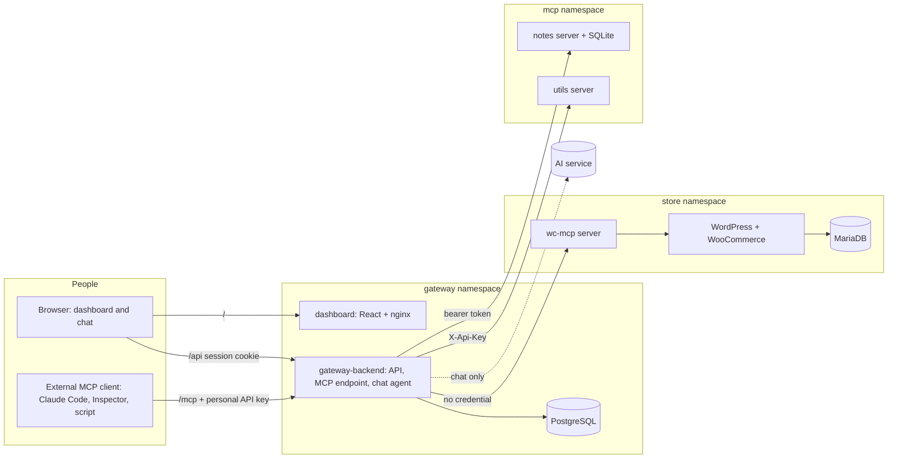

# System design and tradeoffs

## What is built

A WooCommerce store, an MCP server for it, a team gateway that exposes many MCP servers behind one endpoint,
a dashboard, and a chat agent. Everything runs on Kubernetes and is installed with Helm.

Public through Ingress: the storefront, and one host for the dashboard (`/`), the API (`/api`) and the MCP
endpoint (`/mcp`). Internal only (ClusterIP): the three upstream MCP servers, both databases. The upstreams
are additionally locked by NetworkPolicy so that only the gateway pods can connect.

## Components and responsibilities

| Component | Responsibility |
|---|---|
| `charts/store` | WordPress, MariaDB, volumes, ingress, and an idempotent WP-CLI Job that installs WooCommerce |
| `services/wc-mcp-server` | MCP server for the store: list/create products, list/get orders, update order status, over the WooCommerce REST API |
| `services/gateway-backend` | Users, keys, sessions, server registry, tool aggregation and routing, per-role tool permissions, per-key rate limit, Prometheus metrics, audit log, REST API, chat agent |
| `services/dashboard` | React app served by nginx: servers, team, keys, audit log, chat |
| `services/mcp-notes`, `mcp-utils` | Two further upstreams (stateful with bearer auth, stateless with header auth) |

## How a tool call travels

1. A client sends `tools/call` with `Authorization: Bearer <personal key>` to `/mcp`.
2. `McpAuth` hashes the key (SHA-256), looks up its public 8-character id, compares in constant time, and rejects
   revoked keys and disabled users. The database is checked on every request. It then applies the per-key rate
   limit (default 120 requests a minute): over it, the client gets HTTP 429, and one audit row is written per burst.
3. `ToolService.call` splits `woocommerce__list_orders` at the first `__` into server `woocommerce` and tool
   `list_orders`, and checks the server is enabled, **that the caller's role may use that tool** (`permissions.py`;
   a blocked tool is rejected with outcome `rejected`), the server is connected, and it really offers the tool.
   The same rules filter `tools/list`, so a blocked tool is hidden as well as refused.
4. The registry opens a short-lived MCP session to that one upstream, injecting the gateway's **own stored
   credential** for it, and calls the tool under a hard timeout.
5. The result goes back to the client, and one audit row is written (user, key prefix, server, tool, duration,
   outcome, source). The dashboard chat uses the same `ToolService`, so it behaves identically and is audited
   under the signed-in person.

## Tool aggregation, naming, routing and failure handling

- **Naming.** Every tool is exposed as `<server>__<tool>`. Server slugs cannot contain `__`, so the first `__`
  always splits correctly. The prefix is always applied, not only on collision, so a tool's name never
  changes when another server is added. Names above 64 characters are not listed.
- **Listing never calls upstreams.** `tools/list` is answered from an in-memory cache, refreshed every 15 s by
  a background loop that checks each upstream independently. A slow or dead upstream cannot delay listing or
  other servers.
- **States.** `connected`, `unreachable` (after 2 consecutive failures), `disabled`, `unknown`. Only enabled,
  connected servers' tools are listed. A server that comes back reconnects by itself.
- **Timeouts.** Connect 5 s, call 30 s, refresh 10 s (all settings). A timeout becomes a clear tool error and
  an audit row with outcome `timeout`. A call to an unreachable server fails at once with a message that names
  the server and says the others are unaffected.
- **Sessions.** Each call uses a fresh upstream session, so the gateway holds no per-client state.

## Data

PostgreSQL: `users`, `api_keys` (hash only), `sessions` (hash only), `mcp_servers` (credential encrypted with
Fernet), `tool_rules` (role, server, tool or `*`, allow), `audit_log`. The schema is created with `CREATE TABLE IF NOT EXISTS` under an advisory lock at start.

## Kubernetes layout

Namespaces `store`, `gateway`, `mcp`. Secrets: `store-secrets`, `wc-api-credentials`, `gateway-secrets`,
`llm-credentials`, `notes-credentials`, `utils-credentials`, all created by scripts with random values and
never committed. Volumes: WordPress files, MariaDB, PostgreSQL, notes (all `ReadWriteOnce`). Every workload has
readiness and liveness probes and resource requests and limits. Our own services run as a non-root user, with
a read-only root file system (nginx excepted) and all capabilities dropped.

## Local domains

`*.localtest.me` resolves to 127.0.0.1 through public DNS, and k3d maps host port 8080 to the cluster's Traefik
ingress. So `http://store.localtest.me:8080` and `http://gateway.localtest.me:8080` work with no `/etc/hosts`
edits. (A caveat: inside the cluster that name also resolves to 127.0.0.1, which WordPress does not need.)

## Main tradeoffs

| Decision | Chosen | Why, and the cost |
|---|---|---|
| Store access | WooCommerce REST API | Authenticated, validated by WooCommerce, needs only network access. WP-CLI needs exec access to the pod; direct SQL bypasses WooCommerce's rules. |
| Upstream sessions | New session per call | Stateless gateway, trivial scaling and recovery. Costs one extra round trip per call. |
| Tool list | Cached, refreshed in the background | Isolation from slow upstreams. Costs up to 15 s of staleness. |
| API key hashing | SHA-256 | Keys are 256-bit random, so there is nothing to brute-force, and checking happens on every request. Passwords (human-chosen) use scrypt instead. |
| Dashboard auth | Server-side sessions, not JWT | Logout, disabling and resets take effect at once. Costs one database read per request. |
| Tool permissions | Per role, default allow, most specific rule wins | A fresh install behaves as before, and the rules are few enough to read at a glance. Per-person rules and deny-by-default are the next step. Enforced in `ToolService`, so the MCP endpoint and the chat cannot differ. |
| Rate limit and metrics | In memory, hand-written, per replica | No extra service or library to run or explain. The cost: counters are per replica and reset on restart, so a metrics scraper and a shared store are the next step. `/metrics` is not routed by the Ingress. |
| Chat and MCP | One shared `ToolService` | One code path to secure and audit. The chat does not go through HTTP `/mcp`, so it is not the same as an external client over the network. |
| Schema | `CREATE IF NOT EXISTS` | Simple for one release; a migration tool is needed once the schema must change in place. |
| AI service | Any OpenAI-compatible API, free tier by default | No cost and no lock-in. Low rate limits, so the agent trims prompts, retries on 429 and limits each user. |
| Language | Python for all backends | One language to explain. Not the fastest option. |
| Limits kept in memory | Login throttle, chat limiter | Simple. With several gateway replicas each replica counts separately. |

## What changes for production

Same charts, different values. This was run for real on a 4 GB Ubuntu VM running k3s (about 2.1 GB in use); the steps are in
[`deploy-production.md`](deploy-production.md):

- **DNS and ingress.** Real or `nip.io` host names instead of `*.localtest.me`, ports 80/443 instead of 8080,
  `siteUrl` without a port, TLS via cert-manager (`cookieSecure: true` once the site is https).
- **Storage class.** k3s ships `local-path`; on a cloud use a block-storage class, and back up MariaDB,
  PostgreSQL and the WordPress volume (the charts do not do this).
- **Secrets.** The same scripts create them on the server, so they never travel through git. For a team, use
  sealed or external secrets and rotate the bootstrap admin key after first login.
- **Images.** Built for the server's CPU type and imported or pulled from a registry, with version tags
  instead of `dev`.
- **Sizing and replicas.** Raise limits as needed. The gateway is stateless apart from the two in-memory
  counters above, so it can run several replicas.
- **Upgrades and rollback.** `helm upgrade` per chart, `helm history` and `helm rollback` to return to a
  known-good revision. Data volumes are kept across releases.
